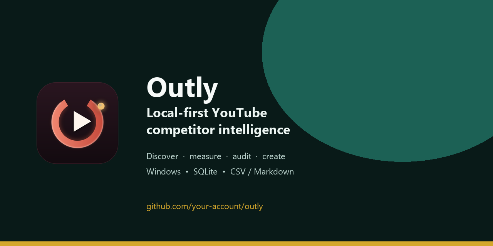

# Outly

**Local-first YouTube competitor intelligence, outlier detection, and content strategy.**

[](https://github.com/aaronclashofclan1-lgtm/Outly/actions/workflows/ci.yml)
[](LICENSE)
[](https://www.python.org/)
[](release/)



Outly helps a creator find the channels that actually compete with their own,
rank them by niche proximity, and surface **outliers** — videos that outperform
their channel's own median. It then turns the measurements into an audit,
content strategy, hooks, video ideas, a production plan, and research briefs.

It runs on your computer. The database is SQLite, the reports are Markdown and
CSV, and API keys stay in a local `.env` file. There is no Outly account, no
telemetry, and no cloud database.

> **Language note:** the documentation in this repository is English. The
> desktop interface shipped in v1.0 is French. Every screen is documented in
> the [user guide](docs/USER_GUIDE.md), including English translations of the
> labels and workflows.

## Why Outly

- **See the real competitive set.** Start from handles, keywords, featured
  channels, your own channel, and description links. Outly does not pretend
  YouTube has a "similar channels" endpoint.
- **Measure, do not guess.** Median views are computed separately for Shorts
  and long videos. An outlier score is views divided by the median of the same
  format.
- **Turn research into production.** Audit, strategy, hooks, ideas, notes,
  whiteboard, editorial plan, and production estimates share one local data
  model.
- **Respect the quota.** Two counters track the `search.list` bucket and the
  main API bucket, with a clean stop before the daily limit.
- **Keep your data.** No account, no analytics SDK, no hidden sync. API-derived
  data is cached locally and expires within 30 days.

## What is included

| Area | What it does |
|---|---|
| Discovery | Seeds, niche keywords, featured channels, channel mentions, cheap filters |
| Enrichment | Latest uploads and public video metrics through the official Data API |
| Scoring | LLM-scored niche proximity with schema validation and local fallback |
| Outliers | Best videos against the channel's own Shorts/long-video median |
| Audit | Sector, evidence-backed diagnosis, competitor practices, 30-day strategy, 10 ideas |
| Studio | Your long videos, Shorts, other content, and competitor view history via OAuth |
| Create | Hooks, video ideas, research briefs, notes, whiteboard, editorial plan, production estimate |
| Reports | `channels.csv`, `outliers.csv`, `report.md`, optional email delivery |
| Desktop | CustomTkinter interface, quota gauges, live logs, import/export, local settings |

## Quick start (Windows executable)

1. Download `Outly.exe` from the [`release/`](release/) folder or from GitHub
   Releases.
2. Put it in its own writable folder and double-click it.
3. On first launch Outly creates `config.yaml`, `positioning.md`, `seeds.txt`,
   `keywords.txt`, and `.env` in that folder.
4. Open **Keys & model** in the app and add a YouTube Data API v3 key and an
   LLM key, or edit `.env` manually.
5. Fill in `positioning.md`, `seeds.txt`, and `keywords.txt`, then run **Launch**.

The executable is **not code-signed**. Windows SmartScreen may show a warning;
choose **More info -> Run anyway** only if you trust the download. See
[docs/INSTALL.md](docs/INSTALL.md) for the full installation and build guide.

## Quick start (from source)

```bash
git clone https://github.com/aaronclashofclan1-lgtm/Outly.git
cd outly
python -m venv .venv
.venv\Scripts\activate
python -m pip install -r requirements.txt
python -m outly init
python -m outly doctor --offline
python -m outly.gui
```

On Windows, `lancer-interface.bat` starts the GUI with the local virtual
environment when one exists. From a terminal, `python -m outly --help` lists
every command.

## Required keys

Outly needs a **YouTube Data API v3** key. Scoring and most generative features
need an **OpenAI-compatible LLM** key. The default configuration points to
Gemini's free tier. Optional integrations are Exa for web research, YouTube
OAuth for private Studio analytics, and Gmail SMTP for email reports.

Copy `.env.example` to `.env` and fill only the services you use:

```text
YOUTUBE_API_KEY=...
LLM_BASE_URL=https://generativelanguage.googleapis.com/v1beta/openai/
LLM_MODEL=gemini-3.5-flash-lite
LLM_API_KEY=...
```

Never commit `.env`. Never paste keys into an issue. Provider-specific setup is
in [`guides/`](guides/README.md).

## The desktop application

The GUI is a local front end over the same files and CLI commands:

- **Home** — readiness, quota, one-click run, Studio summary.
- **Audit & Strategy** — channel audit, diagnosis, content strategy, and
  strategy for recent videos.
- **Studio & Plan** — long videos, Shorts, other content, competitors, editorial
  plan, video schematics, production estimate.
- **Channels & Watch** — sortable channel table, detail panel, comparison,
  local watchlist, competitor history.
- **Notes & Board** — notes library, versions, whiteboard, 3D brain map.
- **Create** — research, ideas, hooks, and the AI brain.
- **Settings** — keys, appearance, budgets, email reports, OAuth.

The complete walkthrough, including every button and the French label
translation, is in [docs/USER_GUIDE.md](docs/USER_GUIDE.md).

## Command line

```bash
python -m outly doctor --offline      # local diagnostics, no network
python -m outly doctor --probe        # one real YouTube call + LLM model list
python -m outly quota                 # today's buckets, Pacific day
python -m outly discover --dry-run    # call plan and estimate, no spend
python -m outly run                   # discover, enrich, score, report
python -m outly audit                 # evidence-backed channel audit
python -m outly report                # CSV and Markdown outputs
python -m outly mail --dry-run        # compose an email without sending
```

All commands are documented in
[docs/CLI_REFERENCE.md](docs/CLI_REFERENCE.md). Exit codes are stable for
automation: `0` success, `2` invalid configuration, `3` quota budget reached,
`4` LLM unavailable, `5` no usable data, `6` email failure.

## Quota model

Since June 2026, YouTube's Data API uses two buckets:

| Bucket | Default ceiling | Cost |
|---|---:|---|
| `search.list` | 100 calls/day | 1 call per request |
| Every other endpoint | 10,000 units/day | 1 unit per call |

Outly keeps both counters, uses the Pacific calendar day, and stops cleanly at
the configured run/daily budgets. Cached calls cost zero. YouTube uploads are
read through the uploads playlist, not through `search.list`; this is both
cheaper and the documented approach.

## Privacy and security

- **Local data.** `data/radar.sqlite3`, preferences, notes, whiteboard, and
  reports stay on your machine.
- **No telemetry.** Outly does not send analytics or usage events.
- **Secrets.** Only `.env` holds API keys, OAuth secrets, refresh tokens, and
  the Gmail app password. It is ignored by Git and never copied into reports.
- **API retention.** Outly caps cached API data at 30 days, as required by the
  YouTube Developer Policies. `python -m outly cache purge` forces cleanup.
- **Third parties.** Requests go only to the endpoints you configure (YouTube,
  your LLM, optional Exa, optional Gmail). Review
  [docs/PRIVACY.md](docs/PRIVACY.md) and [SECURITY.md](SECURITY.md).

## Build the Windows executable

```powershell
py -3.13 -m venv .venv
.\.venv\Scripts\Activate.ps1
python -m pip install -r requirements-dev.txt
.\scripts\build_windows.ps1
```

The script prepares the icon/version metadata, runs PyInstaller with
`Outly.spec`, and copies `dist/Outly.exe` into `release/`. The build is
reproducible from the pinned requirements; it is not code-signed.


## Tests and quality gates

```bash
python -m pytest -q
python -m ruff check . --select E9,F63,F7,F82
python -m pip check
python -m pip_audit -r requirements.txt
```

The public test suite is **365 tests**, with HTTP transports, clocks, and
databases replaced by local fakes. The audit found no known dependency
vulnerabilities at release time.

Known debt: the full Ruff profile reports style findings and mypy is not yet a
strict CI gate. Those are documented as P3 work rather than hidden. The GUI has
limited automated coverage; the data and command layers are the primary tested
surface. See [CHANGELOG.md](CHANGELOG.md) and
[docs/ARCHITECTURE.md](docs/ARCHITECTURE.md).

## Repository layout

```text
outly/              application package (CLI, data, LLM, GUI)
tests/              365 local tests
guides/             provider and OAuth setup guides (English)
docs/               installation, user guide, PDF, architecture, privacy
examples/           safe starter files
release/            portable Windows build and first-run templates
scripts/            build and public-repository verification
.github/            CI, release workflow, issue and PR templates
```

## License

MIT — see [LICENSE](LICENSE). YouTube, Google, Gemini, Groq, Mistral, Ollama,
Exa, and Gmail are trademarks of their respective owners. Outly is independent
and not endorsed by any of them. API-derived data remains subject to the
providers' terms.

## Contributing

Bug reports, provider guides, test coverage, and documentation fixes are
welcome. Read [CONTRIBUTING.md](CONTRIBUTING.md) and
[CODE_OF_CONDUCT.md](CODE_OF_CONDUCT.md). Please do not open a public issue with
a key, token, password, database, or personal channel export; use
[SECURITY.md](SECURITY.md) instead.
